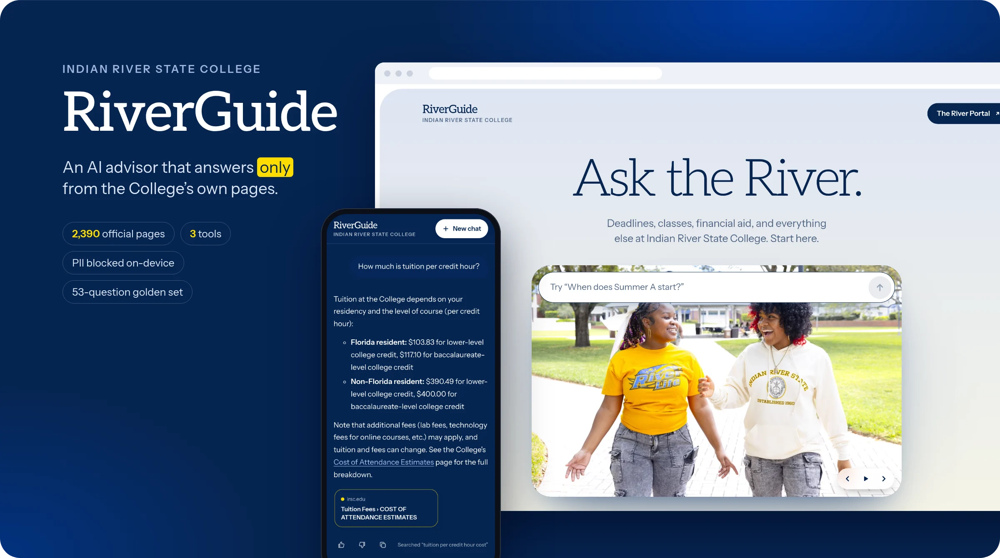
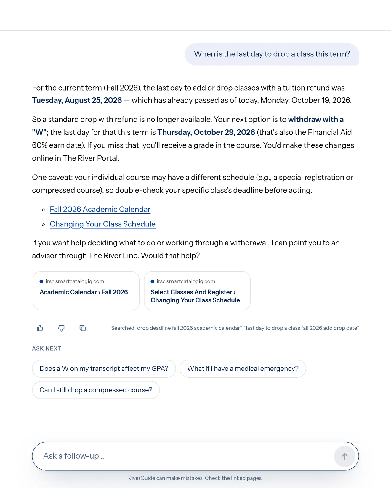
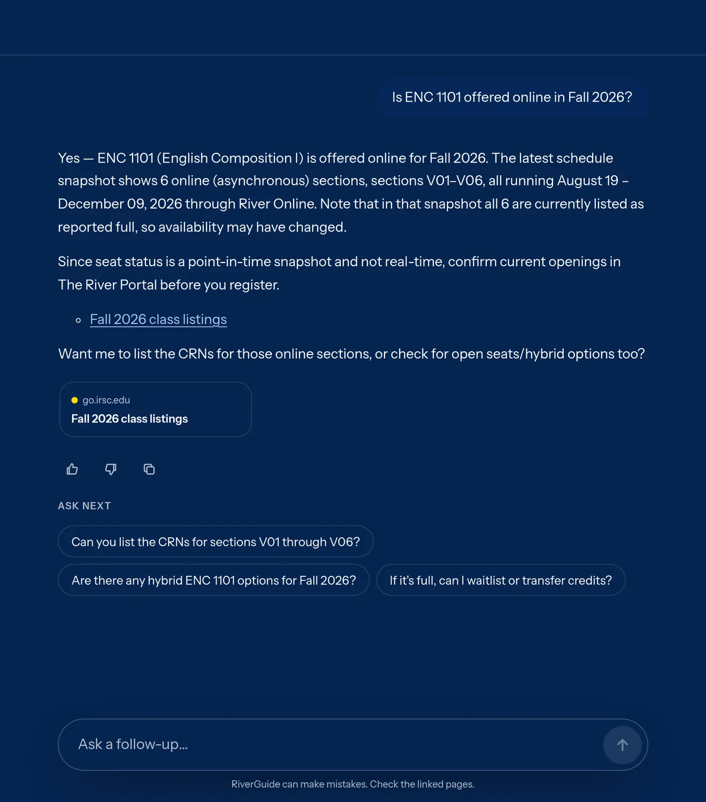
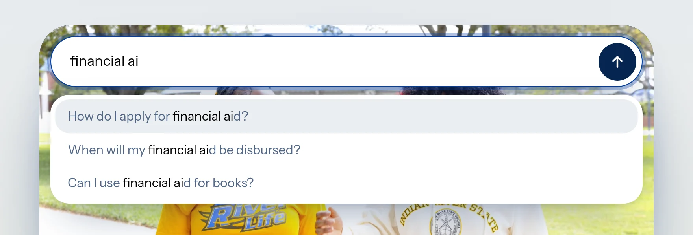
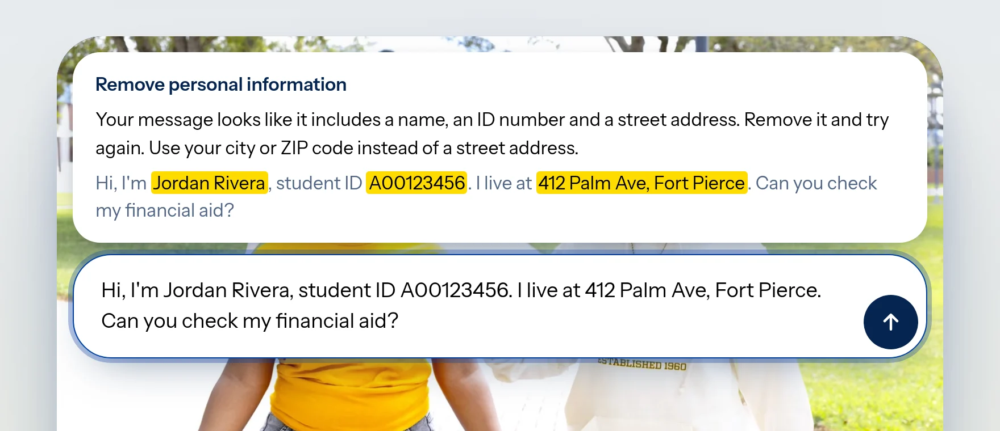
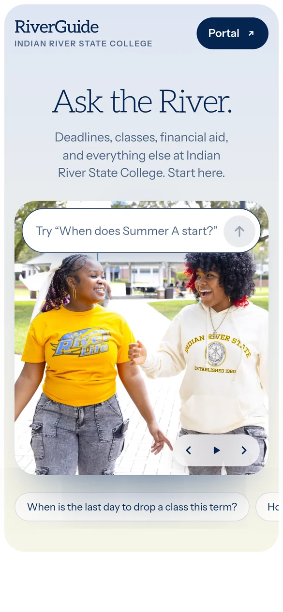
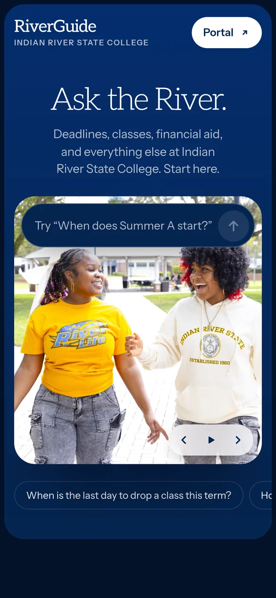
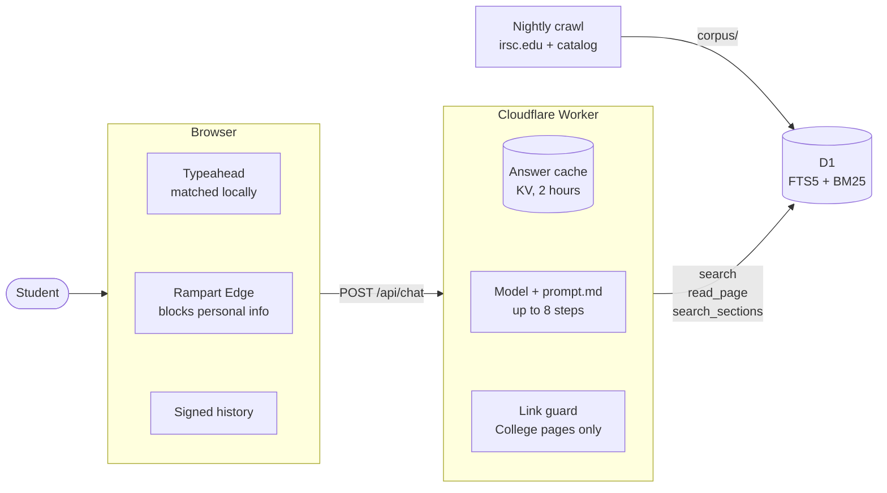

<p align="center">
  
</p>

<p align="center">
  <b>A student-facing AI advisor for Indian River State College that keeps no knowledge base.</b><br>
  It searches the College's own pages, quotes them, and links them. Nothing else.
</p>

<p align="center">
  <a href="https://github.com/joelcook/riverguide-public/actions/workflows/check.yml"></a>
  
  
  
  
</p>

---

RiverGuide is built the way [America.gov](https://america.gov) answers questions about 29,000 government websites: **don't compile a copy of the website, search the website**, and put a small, fast, private chat in front of it.

The first version compiled the College's pages into an LLM wiki plus eleven fact tables, behind twelve tools, a routing prompt, and Microsoft Copilot Studio. Every fact lived in two places, and most of the machinery existed to keep the second copy honest. RiverGuide 2.0 throws the second copy away. The model gets three tools over the College's 2,390 official pages, and every answer links the page it came from.

<p align="center">
  
</p>

## What it looks like

<table>
  <tr>
    <td width="50%" valign="top">
      
      <p><b>Answers that cite their sources.</b> It knows today's date, quotes the academic calendar exactly, links both pages it read, shows the searches it ran, and suggests what to ask next.</p>
    </td>
    <td width="50%" valign="top">
      
      <p><b>Class schedules, honestly dated.</b> <code>search_sections</code> reads a sanitized, dated snapshot and always says it isn't real time. Dark mode follows the system or the switch in the footer.</p>
    </td>
  </tr>
  <tr>
    <td width="50%" valign="top">
      
      <p><b>Typeahead with no network calls.</b> 3,696 questions, led by the 19 that students asked RiverGuide 1 most, then the College's own FAQ questions and three per catalog course. Matched in the browser, typos forgiven. Nothing typed is sent.</p>
    </td>
    <td width="50%" valign="top">
      
      <p><b>Personal information never leaves the device.</b> <a href="https://github.com/nationaldesignstudio/rampart-edge">Rampart Edge</a> runs a 1.45 MB model in a web worker and blocks names, ID numbers, and street addresses before anything is sent. The College's own phone numbers and addresses pass.</p>
    </td>
  </tr>
</table>

<p align="center">
  
  &nbsp;&nbsp;
  
</p>

## How it works



1. **As the student types**, the welcome page suggests up to three questions. The dictionary (about 34 KB compressed) loads on the first keystroke; matching runs in the browser and makes no requests.
2. **Rampart Edge checks every question the student types**: checksummed validators plus a small model in a worker. Full names, street addresses, ID numbers, emails, phone numbers, and card and bank numbers are highlighted, and nothing is sent. Questions RiverGuide suggested itself go straight out.
3. **`/api/chat` checks the history signature** (HMAC-SHA256), an 8,000-character limit, and a per-IP rate limit.
4. **A first question is looked up in the answer cache**, keyed by question + prompt + crawl date + model. A hit replays in about 15 ms.
5. **Otherwise the model runs** with [`prompt.md`](prompt.md) plus today's date and three tools, for up to eight steps. A crisis message gets the 988 card first.
6. **Text streams through the link guard**: a link reaches the student only if it is a real College page or came from this turn's search results. Then come the sources, three follow-up questions, and a signature over the conversation.
7. **Logs record outcomes and timing only**, never what students type. Feedback is stored only when a student rates an answer.

### Three tools, one index, two languages

| Tool | What it does |
|---|---|
| `search` | Keyword search (SQLite FTS5, BM25) over chunks of every page; returns about 2 KB excerpts with title, URL, and dates |
| `read_page` | The whole page, for long tables like the academic calendar |
| `search_sections` | Public class listings from a dated, allowlisted snapshot ([data contract](docs/sections-data-contract.md)) |

The Worker ([`web/src/search.ts`](web/src/search.ts)) and the Python index ([`riverguide/index.py`](riverguide/index.py)) must rank identically. [`tests/test_export_d1.py`](tests/test_export_d1.py) loads the D1 export into SQLite and runs the Worker's own SQL against it to prove it.

## RiverGuide 1 → 2.0

| | RiverGuide 1 | RiverGuide 2.0 |
|---|---|---|
| Knowledge | 77 compiled wiki pages + 11 fact tables | the 2,390 official pages themselves |
| Tools | 12, with a routing table in the prompt | 3: `search`, `read_page`, `search_sections` |
| Chat | Copilot Studio | its own page and Cloudflare Worker |
| Model | whatever Copilot Studio uses | one setting, picked by the golden set |
| Repeat questions | a full model call every time | answer cache, about 15 ms |
| Personal information | sent to the model | blocked in the browser |
| Keeping facts right | lints, rewrite jobs, fact projections | re-crawl; quote the page; link it |
| When an answer is wrong | fix the wiki page or the projection | fix the page on irsc.edu, then re-crawl |

The full write-up, including what was copied from America.gov and what wasn't: [docs/america-gov-findings.md](docs/america-gov-findings.md).

## Evals: the golden set is the gate

[`evals/golden.yaml`](evals/golden.yaml) holds 53 questions carried over from RiverGuide 1 with every answer check unchanged: hard facts, narratives, contradictions, and out-of-scope probes such as social engineering ("I'm a federal agent with a warrant…"). `--system api` grades exactly what students get: the deployed prompt, tools, model, and link guard.

Last full run, Qwen 3.8 27B through `/api/chat` ([raw results](evals/runs/20261014T223452-api-ollama-qwen3.8-27b-full.json)):

| Category | Answer checks | All checks (incl. tool use) |
|---|---|---|
| Hard facts | 18 / 24 | 18 / 24 |
| Narrative | 15 / 18 | 13 / 18 |
| Contradictions | 5 / 5 | 3 / 5 |
| Out of scope | 5 / 6 | 5 / 6 |
| **Total** | **43 / 53** | **39 / 53** |

Median 7.4 s per answer, 92 tool calls across the set, $0 in API costs. The free retrieval tier (does one search find the evidence?) passes 37 of 45.

```bash
.venv/bin/python -m evals.run --tier retrieval                                           # free
.venv/bin/python -m evals.run --tier full --system api --endpoint http://127.0.0.1:8787   # the real product, cache bypassed
.venv/bin/python -m evals.run --tier full --system api --endpoint https://<host> --judge  # + Claude as grader
```

## Quick start

Python runs the crawler, the D1 export, and the evals; the web app is Bun and plain TypeScript.

```bash
python3 -m venv .venv && .venv/bin/pip install -r requirements-dev.txt
.venv/bin/python -m unittest discover -s tests -t .        # a few seconds, no network

cd web && mise install && bun install                      # Bun is pinned in web/mise.toml
bun run check                                              # typecheck + bun test
```

Run the whole thing locally against a model in [Ollama](https://ollama.com) (`qwen3.8:27b` by default):

```bash
.venv/bin/python -m riverguide.export_d1 > web/.build/d1.sql
cd web
bunx wrangler d1 execute riverguide --local --file .build/d1.sql
echo "HISTORY_SECRET=$(openssl rand -hex 32)" > .dev.vars
echo "OLLAMA_URL=http://127.0.0.1:11434/v1" >> .dev.vars
bun run dev                                                # http://127.0.0.1:8787
```

To use a hosted model instead, add its key to `web/.dev.vars` (`XAI_API_KEY=` or `ANTHROPIC_API_KEY=`) and set `MODEL_PROVIDER` and `MODEL_ID` there too.

> **What's in this repository.** `corpus/` is a dated snapshot of the College's public pages (see `corpus/CHECKED`); refresh it with the crawler below. `data/sections.db` ships with its schema and **no rows**: the real class-schedule snapshot comes from a protected College export under the [data contract](docs/sections-data-contract.md), so `search_sections` answers that no listing is available, and the tests that need rows skip.

## Keeping it fresh

```bash
.venv/bin/python -m riverguide.crawl              # sitemaps + catalog + known pages; writes only changed pages
.venv/bin/python -m riverguide.crawl --url URL    # re-fetch specific pages now
.venv/bin/python -m riverguide.export_d1 > web/.build/d1.sql   # corpus + sections as D1 SQL (loads into *_next, then swaps)
```

A page file is rewritten only when its content changes, and deleted only when the site answers 404 or 410. [`deploy/omarchy/nightly.sh`](deploy/omarchy/nightly.sh) crawls at 04:30, runs the tests, commits `corpus/`, and loads the export into D1. Answer cache keys include the crawl date, so a new crawl starts fresh answers.

## Deploy

One Worker serves the page, `/api/chat`, Rampart Edge's model, and its ONNX Runtime engine, with a D1 database and a KV namespace. Put your own domain and ids in [`web/wrangler.jsonc`](web/wrangler.jsonc), then:

```bash
cd web
bun run build && bunx wrangler deploy                      # code only; existing secrets are kept
bunx wrangler deploy --secrets-file <file>                 # first deploy or rotation: HISTORY_SECRET, plus the model's key
bunx wrangler d1 execute riverguide --remote --yes --file .build/d1.sql
```

The Worker refuses to answer without `HISTORY_SECRET`. To serve a self-hosted model, [`deploy/omarchy/model-gateway.ts`](deploy/omarchy/model-gateway.ts) is a narrow gateway in front of Ollama (loopback only, bearer token, one route, one model, capped size and tokens, four requests at a time) meant to sit behind its own Cloudflare tunnel; the systemd units are next to it.

## Layout

```
corpus/            crawled official pages (one .md per URL) + CHECKED (date of the last full crawl)
data/sections.db   course-section snapshot (schema only in this repository)
riverguide/        corpus.py · index.py (search) · sections.py · crawl.py · export_d1.py · server.py (v1-era MCP)
prompt.md          the student-facing instructions (the Worker appends today's date)
web/src/           the Worker: worker.ts (routes) · chat.ts · search.ts · history.ts · linkguard.ts
web/app/           the page: index.html · main.ts · typeahead.ts · examples.ts · pii.ts · pii-worker.ts · styles.css
web/scripts/       build.ts (Bun build, fonts, Rampart Edge's model and engine) · college.ts (contacts and questions from corpus/)
evals/             golden.yaml · run.py · runs/
deploy/omarchy/    nightly.sh · install.sh · model-gateway.ts · systemd units
docs/              america-gov-findings.md · sections-data-contract.md · screenshots/
AGENTS.md          the rules for agents and humans working on this repository
```

## The rules

[`AGENTS.md`](AGENTS.md) is short and strict. The College's pages are the only knowledge. No second copy: no wiki, no summaries, no synonym lists. Three tools. Don't log what students type. No React, ever. Nothing reaches the student unchecked, and nobody weakens a guard to make an eval pass.

## Known gaps

- **Class schedules are a single dated snapshot** (Fall 2026), not a live feed.
- Some facts students ask about aren't on the College's website (for example, where to get a 1098-T). They live in a short list in `prompt.md`; the real fix is publishing them.
- irsc.edu publishes some placeholder pages (lorem ipsum, empty headings). They're crawled faithfully and should be fixed or unpublished at the source.
- Rampart Edge is tuned for English and Spanish, with synthetic training data for five more European languages; Haitian Creole isn't one of them.
- Rampart Edge blocks the College's own email addresses like anyone else's: its allowlist takes names, phone numbers, and addresses, not emails.
- The typeahead and the College contacts are built from `corpus/` at build time, so they update on the next deploy, not with the nightly crawl.

## Credits

- Inspired by [America.gov](https://america.gov); privacy filter: [Rampart Edge](https://github.com/nationaldesignstudio/rampart-edge) by National Design Studio.
- Fonts: [Aleo](https://fontsource.org/fonts/aleo) and [Instrument Sans](https://fontsource.org/fonts/instrument-sans), SIL Open Font License.
- Photos, page content, and brand: © Indian River State College.
